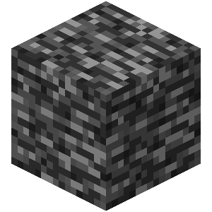
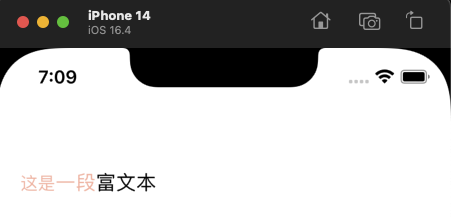
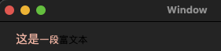
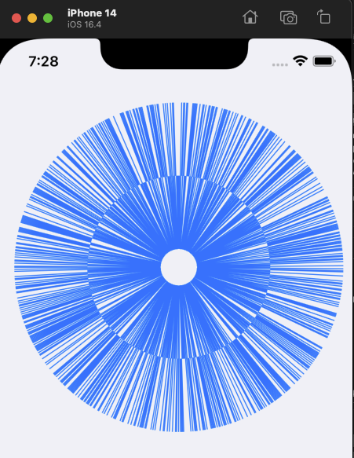
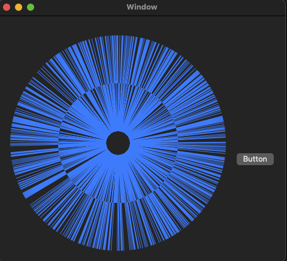

# AxcBedrock

[](./LICENSE)
[](./Package.swift)
[](https://cocoapods.org/pods/AxcBedrock)


[CI / GitHub Actions](https://github.com/axclogo/AxcBedrock-Swift/actions/workflows/swift.yml)

# Language

- en [English](./README.md)
- zh_CN [简体中文](./README.zh_CN.md)

# Introduce
<br>
AxcBedrock is a basic tool library that provides commonly used functions and extensions for iOS and macOS applications.

Like Bedrock in MineCraft, as the foundation of the world, it bears all the blocks.

## Swift and Dart

[AxcBedrock-Swift](https://github.com/axclogo/AxcBedrock-Swift) provides helpers for iOS and macOS. [AxcBedrock-Dart](https://github.com/axclogo/AxcBedrock-Dart) provides a pure Dart core and a separate Flutter package for geometry and painting helpers.

Both share the `value.axc.operation` approach and align common capabilities where the languages allow it. They use native types and keep platform differences explicit; the Dart version does not reproduce every Apple framework extension. See the [API comparison](https://github.com/axclogo/AxcBedrock-Dart/blob/master/doc/api-parity.md). Dart is currently an unpublished `2.0.0-dev.1` development version.

The main idea is to establish coherence in development, not limited to one platform or one language, to connect developers' habits, and to unify the invocation of all underlying APIs or simple small operations.

In terms of functionality, it is similar to [SwifterSwift](https://github.com/SwifterSwift/SwifterSwift), with the main difference being in invocation and use.

For example, SwifterSwift is based on direct extension functions, but because of too many extensions in a large project, when calling APIs and finding APIs, Xcode's completion may cause lagging and it may be difficult to find the needed API.

Therefore, AxcBedrock is based on namespace mode encapsulation, with the suffix ".axc" added where it needs to be invoked, and then the corresponding API can be searched.

I can't say there are many projects, but in the projects I am involved in, this solution really solves the problem of code completion creeping in. It also has good aesthetics and will not cause naming conflicts with the extensions of the main project.


# A note from the author

I finally found some time to use Codex to wrap up this stage of both the Swift and Dart projects: bringing the small helpers, examples, tests, and documentation together, rather than leaving the original idea unfinished indefinitely.

In the AI era, I honestly do not know how much value libraries like these still have. Finishing what I set out to do gives me some closure. If it helps someone else along the way, even better.

My focus is now on Agent research and [AxcAgentEngine](https://github.com/axclogo/AxcAgentEngine). These two libraries will stay within their current scope for now, with no commitment to regular updates. If more people use them and clear needs emerge, I will consider continuing maintenance.

# Install
You can install AxcBedrock using CocoaPods or Swift Package Manager:

## CocoaPods

Podfile:
```ruby
pod 'AxcBedrock'
```

## Swift Package Manager

Add the following to your `Package.swift` dependencies:
```swift
dependencies: [
    .package(url: "https://github.com/axclogo/AxcBedrock-Swift.git", branch: "master")
]
```

Or in Xcode: File → Add Package Dependencies → Enter the repository URL.

This example follows the current development branch, which includes the helpers described below. Pin a reviewed revision when you need a reproducible dependency; this README does not imply a new tagged release.

Available products:
- `AxcBedrock` and `AxcBedrockCore` — Both expose the `AxcBedrockCore` target, including platform extensions selected at compile time.

Use `import AxcBedrockCore` with SwiftPM; CocoaPods uses `import AxcBedrock`.
The declared minimum platforms are iOS 10.0 and macOS 11.0. SwiftPM uses tools version 5.3
and Swift 5 language mode; the podspec uses `swift_version = '5.0'`.
These are Apple-platform libraries; the Core name does not imply Linux support.

Alternatively, you can manually add the source code to your project.

# Usage
Import `AxcBedrockCore` with SwiftPM, or `AxcBedrock` with CocoaPods, to use the functions and extensions below.

## Format/Specification
All API usage follows this naming convention:
```swift
// Call instance function:
xxxx.axc.xxxx
// Call class function:
Xxxx.Axc.Xxxx
```
In this way, you can easily access all the functions and extensions you need.

## Examples
### Foundation helpers

The library includes typed associated objects, an instance-scoped once token, and small
numeric/geometry helpers. Existing Insets and image APIs are reused; no additional image wrapper is needed.

```swift
private enum Keys {
    static let title = AxcAssociationKey<String>()
    static let delegate = AxcAssociationKey<NSObject>.Weak()
}
let object = NSObject()
AxcRuntime.Set(object: object, key: Keys.title, value: "Title")
let title: String? = AxcRuntime.GetObject(object, key: Keys.title)
AxcRuntime.Remove(object: object, key: Keys.title) // Only this key

let once = AxcOnce() // Store as an instance property, or static let to share
once.run { print("Runs once on the calling thread") }

let progress = 1.5.axc.clamped(to: 0.0...1.0) // 1.0
let finite = CGRect(x: 0, y: 0, width: 10, height: 20).axc.isFinite
let insets = AxcBedrockEdgeInsets.Axc.Create(horizontal: 2, vertical: 3)
let total = insets.axc.horizontal // 4; vertical is 6
let size = CGSize(width: 10, height: 20).axc.add(edge: insets)
```

- **Associated objects** (`Utils/Runtime`): each key instance has its own identity and value type.
  Hosts must be `NSObject` instances that support Objective-C associated objects. Default keys retain values;
  `Weak()` keys use the existing `AxcWeakObj` and return nil after the value is released.
  Passing nil removes a value. Active associations retain their key to prevent address reuse.
  Individual reads/writes use atomic Runtime retention, but read-modify-write sequences and value internals
  require caller synchronization. Strong reference cycles remain the caller's responsibility.
  Copying is explicit at the call site; no generic copy policy is provided because `NSCopying` need not
  preserve a concrete Swift subtype. The existing raw Runtime functions remain in use internally.
- **Once** (`Utils/GCD`): one synchronous, nonthrowing body per `AxcOnce` instance, no reset or global token table.
  `run` returns true for the winning caller and false for later or reentrant callers. Concurrent losers
  return without waiting for the body to finish. This is not an initialization completion barrier.
  Store the token for the required lifetime; creating a new token on every call does not share state.
  Prefer Swift's `static let` when only initializing a shared value.
- **Numbers and geometry** (`Extension/SwiftLib`, `Extension/CoreGraphics`): `clamped(to:)` takes a valid
  `ClosedRange`, preserves NaN, and clamps infinities to the bounds. `CGPoint`, `CGSize`, and `CGRect`
  expose `.axc.isFinite`; rectangles also reject null/infinite sentinels and overflowing edges.
  Zero and negative sizes are allowed by this finiteness check; it does not promise positive layout sizes
  or safe divisors. Use native `isEmpty`, `isNull`, `isInfinite`, and `standardized` for their respective semantics.
- **Insets and images** (`Extension/CrossPlatform/AppKitAndUIKit/Typealias`): reuse Insets
  `horizontal`, `vertical`, `add(edge:)`, `CGSize.axc.add/subtract(edge:)`, and `inset(rect:)`.
  `AxcBedrockImage` already aliases `UIImage` on iOS and `NSImage` on macOS, retaining native identity
  and behavior. It does not unify platform-specific scale or coordinate semantics; `AxcUnifiedImage`
  remains the existing input conversion protocol.

The new files are covered by the existing SwiftPM source directories and CocoaPods globs.
Runtime, once, and clamping live in CocoaPods Core; geometry, Insets, and images require the platform sources.
Run the core regression suite with `swift test` on macOS. iOS compilation/tests require Xcode and an iOS SDK.

### Example Call
Here is a simple example to demonstrate how to use the functionality in AxcBedrock:

```swift
import AxcBedrock

let myString = "hello world"
let testString = myString.axc.keepPrefix(count: 3)
print(testString) // "hel"
```

### AttributedText Operations
```swift
let attText = "这是一段富文本".axc.makeAttributed { make in
    make.set(font: 15, range: 0...1)
    make.set(foregroundColor: "FFBBAA", range: NSRange(location: 0, length: 4))
}
```
| iOS performance | MacOS performance |
| ---------------- | ---------------- |
| <br>  | <br>  |

Note that the classes AxcUnifiedXXX are universal classes. For example, the classes for setting font and color in the example above are:

AxcUnifiedFont and AxcUnifiedColor.

These classes can be used interchangeably and can be written in the following ways:

**AxcUnifiedFont:**
```swift
make.set(font: 15.axc.uiFont, range: 0...1)
make.set(font: 15.4, range: NSRange(location: 0, length: 4))

make.set(font: UIFont.systemFont(ofSize: 15), range: 0...1)
make.set(font: UIFont.systemFont(ofSize: 15), range: NSRange(location: 0, length: 4))
```

**AxcUnifiedColor:**
```swift
.set(foregroundColor: "FFBBAA", range: 1...2)
.set(foregroundColor: "FFBBAA", range: NSRange(location: 0, length: 4))

.set(foregroundColor: UIColor.red, range: 1...2)
.set(foregroundColor: UIColor.red, range: NSRange(location: 0, length: 4))

.set(foregroundColor: 0xFFBBAA, range: 1...2)
.set(foregroundColor: 0xFFBBAA, range: NSRange(location: 0, length: 4))
```
Of course, both UIColor and NSColor are supported, but they must be used on the corresponding platform.

### Bezier Operation
```swift
var linesHeight: [AxcUnifiedNumber] = []
for i in 0...1000 {
    if (arc4random() % 2) == 0 {
        linesHeight.append(80)
    }else{
        linesHeight.append(-80)
    }
}
let bz = UI/NS BezierPath.Axc.CreateRadiateCircle(center: center,
                                                  radius: radius,
                                                  linesHeight: linesHeight,
                                                  clockwise: .clockwise,
                                                  startAngle: .direction(.left),
                                                  openingAngle: 0,
                                                  isReversing: false)
shapeLayer.path = bz.axc.cgPath
```
| iOS performance | MacOS performance |
| ---------------- | ---------------- |
| <br>  | <br> 

Even across platforms, one codebase is enough.

## For a complete list of available functions and extensions in AxcBedrock, please refer to the code or export the Swift-Docc documentation.

# Question
If you encounter any issues or errors while using AxcBedrock, please submit an issue on GitHub.

If you are unsure or unclear about any API while using it, you can also submit an issue on GitHub.


# Connection
E-mail：axclogo@163.com

QQ：532432339 

# Contribution
AxcBedrock is open source and thanks for any contributions. If you find any errors or want to improve the library, please submit a pull request.

Issues with reproducible examples, focused fixes, and tests are welcome. SwiftPM support and the Dart counterpart are already present. Future maintenance will depend on actual usage and available time; there is no promised response or release schedule.

# LICENSE
AxcBedrock is available under the MIT license. See the LICENSE file for more info.

# Please give a Star⭐️ to this repository if it has been helpful to you or has inspired you in any way. ~ ~ Thanks♪(･ω･)ﾉ
