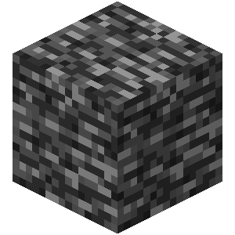
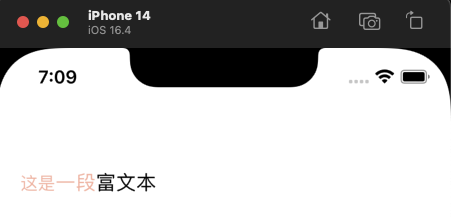
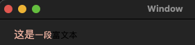
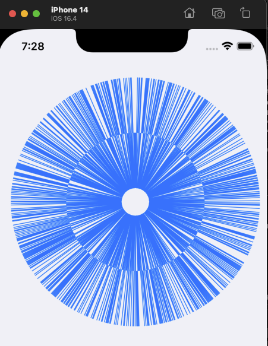
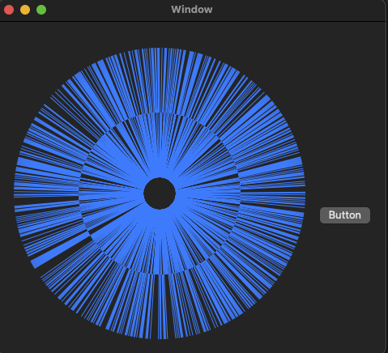

# AxcBedrock


[](https://cocoapods.org/pods/AxcBedrock)


# 语言
- en [English](./README.md)
- zh_CN [简体中文](./README.zh_CN.md)

# 介绍
<br>
AxcBedrock是一个基础的工具库，为iOS和macOS应用程序提基础供常用的函数和扩展。

如同MineCraft中的基岩一样，作为世界基础，承担起所有方块。

在将来，还会继续支持Dart等语言（时间够的话😄）[Dart版本点这里（还在开发中..）](https://github.com/axclogo/AxcBedrock-Dart) 

主要思想是想打通开发的连贯性，不局限于一个平台或一个语言，打通开发人员的习惯，让所有底层Api或简单小操作的调用统一

功能方面与[SwifterSwift](https://github.com/SwifterSwift/SwifterSwift)相似，主要的区别在于调用和使用。

例如SwifterSwift是基于extension直接做的功能，但是由于大项目中的extension存在过多，在调用api和查找api时Xcode的补全可能会存在卡顿、api过多无法找到需要的问题

所以AxcBedrock是基于命名空间模式的封装，在需要调用的地方打出.axc，然后查找对应的api即可。

不敢说很多项目，但是我在做的项目中这个方案确实解决了代码补全侵染的问题，也具有良好的美观性，并且不会和主项目的extension造成命名重复的问题。


# 安装
您可以使用CocoaPods快速安装AxcBedrock:

Podfile:
```ruby
pod 'AxcBedrock'
```
您也可以手动将源代码添加到项目中。

## Swift Package Manager

在 Xcode 的 Add Package Dependencies 中添加本仓库地址，选择 `AxcBedrock` 或
`AxcBedrockCore` 产品；两者都导出同一个 `AxcBedrockCore` target，包含按平台条件编译的扩展。
SwiftPM 使用 `import AxcBedrockCore`，CocoaPods 使用 `import AxcBedrock`。

最低平台声明保持 iOS 10.0 / macOS 11.0。SwiftPM tools version 为 5.3、语言模式为 Swift 5，
podspec 的 `swift_version` 为 `5.0`。Core 名称不表示支持 Linux。

# 用法
SwiftPM 项目使用 `import AxcBedrockCore`，CocoaPods 项目使用 `import AxcBedrock`，即可调用以下函数和扩展。

## 格式/规范
所有API使用都遵循这种格式的命名规范：
```swift
// 实例功能调用：
xxxx.axc.xxxx
// 类功能调用
Xxxx.Axc.Xxxx
```
以此可轻松访问您需要的所有函数和扩展。

## 部分示例
### 通用基础能力

| 候选能力 | 判断 | 落点与范围 |
| --- | --- | --- |
| 类型安全关联对象 | 实现 | `Utils/Runtime`：类型化 Key、读取、写入、单键移除、强/弱持有，复用现有 Runtime 与弱引用工具 |
| 一次性执行 | 实现 | `Utils/GCD`：`AxcOnce` 实例令牌，不引入全局字符串注册表 |
| 数值与几何辅助 | 实现缺口、复用已有能力 | `Extension/SwiftLib` 增加区间限制，`Extension/CoreGraphics` 增加有限性判断；Insets 已有总量和必要运算 |
| 跨平台图片类型 | 实现（已有，直接复用） | `AxcBedrockImage` 已统一 `UIImage` / `NSImage`，不新增第二套类型 |

```swift
private enum Keys {
    static let title = AxcAssociationKey<String>()
    static let delegate = AxcAssociationKey<NSObject>.Weak()
}
let object = NSObject()
AxcRuntime.Set(object: object, key: Keys.title, value: "标题")
let title: String? = AxcRuntime.GetObject(object, key: Keys.title)
AxcRuntime.Remove(object: object, key: Keys.title) // 不影响其他关联值

let once = AxcOnce() // 实际使用时保存为实例属性，或 static let 以共享
once.run { print("在调用线程执行一次") }

let progress = 1.5.axc.clamped(to: 0.0...1.0) // 1.0
let finite = CGRect(x: 0, y: 0, width: 10, height: 20).axc.isFinite
let insets = AxcBedrockEdgeInsets.Axc.Create(horizontal: 2, vertical: 3)
let total = insets.axc.horizontal // 4；vertical 为 6
let size = CGSize(width: 10, height: 20).axc.add(edge: insets)
```

- **关联对象**：键按实例身份区分，同类型的不同键不会串值，建议使用 `static let` 保存。
  宿主限支持 Objective-C 关联对象的 `NSObject` 实例。默认强持有；`Weak()` 复用 `AxcWeakObj`，
  值释放后读取为 nil。写入 nil 或 `Remove(object:key:)` 仅移除此键。
  活跃关联会持有键，避免局部键提前释放后地址复用；宿主释放或关联移除时释放存储。
  单次读写采用 Runtime 原子持有策略，读后修改再写回及值内部状态仍需调用方同步。
  强引用循环由调用方避免。复制需求在写入前显式处理：`NSCopying` 不保证返回原具体子类型，
  因此不向泛型接口提供可能破坏类型约束的 copy 策略。底层指针接口仍有仓库内部调用，本次继续复用。
- **一次性执行**：每个 `AxcOnce` 实例最多执行一个同步、不可抛错的闭包，无重置功能。
  `run` 的首次调用执行并返回 true，后续调用和重入返回 false。并发竞争者不等待首个闭包完成，
  所以它不是初始化完成屏障。对象属性对应对象级范围，`static let` 对应该静态属性的共享范围；
  每次新建令牌不会共享执行记录。仅初始化共享值时优先使用 Swift 自带的 `static let`。
- **区间与几何**：`clamped(to:)` 接收有效闭区间，NaN 保持原样，无穷按边界截取。
  `CGPoint`、`CGSize`、`CGRect` 使用 `.axc.isFinite` 检查有限性，矩形额外排除 null/infinite
  哨兵和边界相加溢出。零和负尺寸允许通过，不代表正布局尺寸或可安全作为除数。
  [Core Graphics 本身允许负矩形尺寸](https://developer.apple.com/documentation/coregraphics/cggeometry)；
  空矩形、空值、无限矩形和标准化分别使用系统 `isEmpty`、`isNull`、`isInfinite`、`standardized`，不再重复封装。
- **Insets 与图片**：复用 `horizontal`、`vertical`、`add(edge:)`、`CGSize.axc.add/subtract(edge:)`
  和 `inset(rect:)`。`AxcBedrockImage` 在 iOS 为 `UIImage`，macOS 为 `NSImage`，不引入包装分配；
  平台特有的缩放和坐标语义仍遵循原生类型。`AxcUnifiedImage` 继续承担已有输入转换职责。

暂缓全局 token 注册表、异步/抛错重试式 once 和更多 Insets 运算；当前没有具体调用需求。
重复图片包装及对系统现成功能的同义封装不适合加入。

新增文件自动进入现有 SwiftPM sources 和 CocoaPods 文件通配规则。Runtime、once 和区间限制位于
CocoaPods Core；几何、Insets 和图片随平台源码引入。macOS 核心回归测试运行 `swift test`；
iOS 编译和测试需要完整 Xcode 及 iOS SDK。

### 调用示例
以下是一个简单的示例，演示如何使用AxcBedrock中的功能：

```swift
import AxcBedrock

let myString = "hello world"
let testString = myString.axc.keepPrefix(count: 3)
print(testString) // "hel"
```

### 富文本操作示例
```swift
let attText = "这是一段富文本".axc.makeAttributed { make in
    make.set(font: 15, range: 0...1)
.set(foregroundColor: "FFBBAA", range: NSRange(location: 0, length: 4))
}
```
| iOS表现 | MacOS表现 |
| ---------------- | ---------------- |
| <br>  | <br>  |

需要注意的是，AxcUnifiedXXX的类为通用类，例如上面示例的设置Font和Color的类分别为：

AxcUnifiedFont和AxcUnifiedColor

这样的类可以兼容并采取以下写法：

**AxcUnifiedFont:**
```swift
make.set(font: 15.axc.uiFont, range: 0...1)
make.set(font: 15.4, range: NSRange(location: 0, length: 4))

make.set(font: UIFont.systemFont(ofSize: 15), range: 0...1)
make.set(font: UIFont.systemFont(ofSize: 15), range: NSRange(location: 0, length: 4))
```

**AxcUnifiedColor:**
```swift
.set(foregroundColor: "FFBBAA", range: 1...2)
.set(foregroundColor: "FFBBAA", range: NSRange(location: 0, length: 4))

.set(foregroundColor: UIColor.red, range: 1...2)
.set(foregroundColor: UIColor.red, range: NSRange(location: 0, length: 4))

.set(foregroundColor: 0xFFBBAA, range: 1...2)
.set(foregroundColor: 0xFFBBAA, range: NSRange(location: 0, length: 4))
```
当然，无论UIColor还是NSColor都可以支持，但是要在对应的平台上使用

### 贝塞尔曲线操作示例
```swift
var linesHeight: [AxcUnifiedNumber] = []
for i in 0...1000 {
    if (arc4random() % 2) == 0 {
        linesHeight.append(80)
    }else{
        linesHeight.append(-80)
    }
}
let bz = UI/NS BezierPath.Axc.CreateRadiateCircle(center: center,
                                                  radius: radius,
                                                  linesHeight: linesHeight,
                                                  clockwise: .clockwise,
                                                  startAngle: .direction(.left),
                                                  openingAngle: 0,
                                                  isReversing: false)
shapeLayer.path = bz.axc.cgPath
```
| iOS表现 | MacOS表现 |
| ---------------- | ---------------- |
| <br>  | <br> 

即便是跨平台，一份代码也够了

## 更多有关AxcBedrock中可用函数和扩展的完整列表，请参见代码或导出Swift-Docc文档。

# 问题
如果您在使用AxcBedrock时遇到问题或错误，请在GitHub上提交问题。

如果您在使用过程中，不知道或不明白有哪些Api，也可以在GitHub上提交问题。

# 联系
E-mail：axclogo@163.com

QQ：532432339 

# 贡献
AxcBedrock是开源的，并感谢任何形式的贡献。如果您发现错误或想改进库，请提交拉取请求。

**目前需协助帮忙~如果有想法的请联系我！或者提PR，谢谢！Orz**

## 需要协助一起的任务还有：
- 完善单元测试部分
- 支持Swift Package Manager
- 如果有需要优化的地方，提出优化项
- 如果有想一起开发Dart版的Bedrock，请联系我！

# 证书
AxcBedrock is available under the MIT license. See the LICENSE file for more info.

# 如果这个库有帮助到你，或者帮助你启发了什么，请给个Star⭐️ ~ ~ Thanks♪(･ω･)ﾉ

